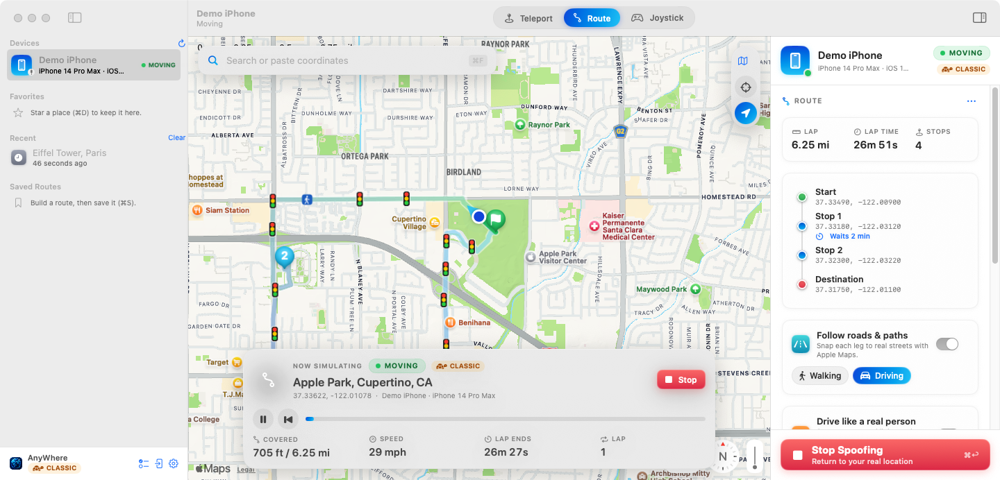
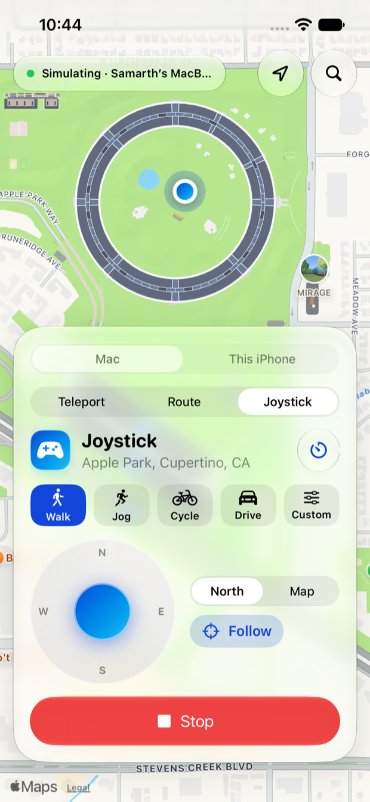
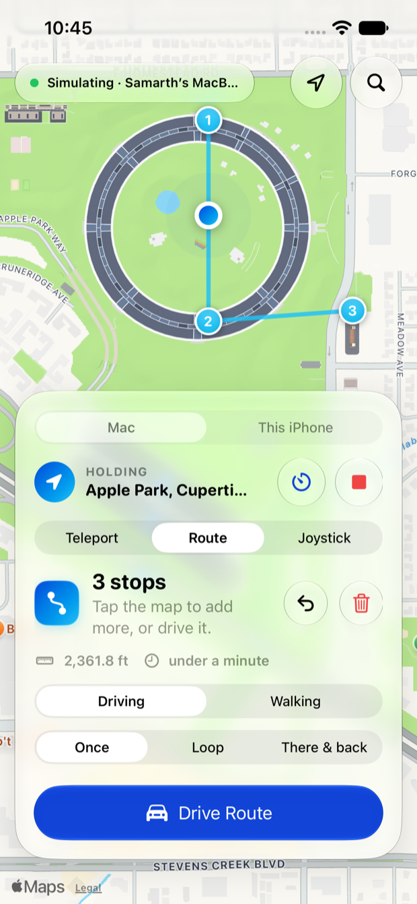
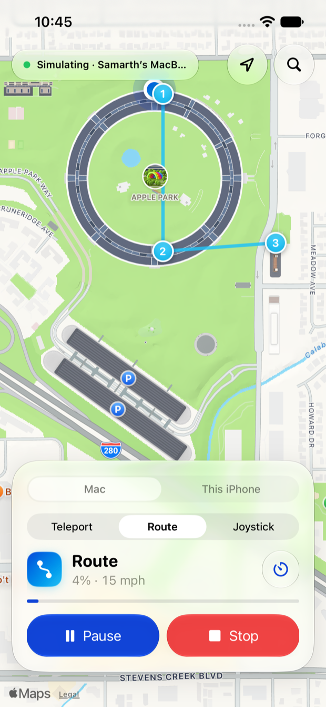

# AnyWhere™

Change your iPhone's GPS location from your Mac. Jump anywhere in the world,
drive a route on real roads, or steer with a joystick. Nothing gets installed
on the iPhone, and your real location comes back when you press **Stop**.



The iPhone app, AnyWhere, steers the Mac from your pocket:

**Standalone beta (iPhone build 5):** choose **This iPhone** to execute teleport, joystick, routes and
automatic stop locally with the Mac powered off after setup. You can import Apple developer-image
files for loading support after a restart. This targets iOS 17+, but compatibility on every version
is **not verified**; iOS 17.0–17.3 is an experimental Remote Pairing attempt. The published v2.4.0 IPA
is build 4 and lacks these additions. See [setup](docs/PHONE-ONLY.md),
[device tests](docs/PHONE-STANDALONE-TESTING.md) and [repository audit](docs/REPOSITORY-AUDIT.md).

| Joystick | Build a route | Route driving |
|:---:|:---:|:---:|
|  |  |  |

## What you need

- A Mac with **macOS 14 Sonoma** or newer. The downloadable app (Option 1) is for **Apple silicon** Macs
  (M1 or newer). On an Intel Mac, use Option 2, which needs **macOS 14.5 or newer** with Swift 6 (Xcode 16 or
  Apple's Command Line Tools).
- An **iPhone or iPad**. iOS 17 or newer works best.
- A **USB cable that carries data**. The cable that came with your iPhone works.
  Some cheap cables only charge.

## Install

There are two ways. **Option 1 is the easiest and the one to try first.**

### Option 1: download the app (about 1 minute)

1. Open the
   [Releases page](https://github.com/renyifan2009-hash/iOS-GPS-Spoofer-V1.2.3/releases/latest)
   and download **AnyWhere-…dmg**.
2. Open the downloaded file and drag **AnyWhere** onto **Applications**.
3. Open **AnyWhere** from Applications. macOS says it can't verify the app
   (it isn't from the App Store). That is expected. Open **System Settings ▸
   Privacy & Security**, scroll down to the message about AnyWhere and click
   **Open Anyway**. You only do this once.
4. The app offers to install its small helper tool the first time. Click
   **Install**.

This is the same file the project's automatic checks build and test (on
macOS 15, with Xcode 16 and Xcode 26). It is built for Apple silicon Macs.

### Option 2: build it on your Mac (about 5 minutes)

Use this if you can't download the app, or you want the very newest changes.

1. Open **Terminal**. Press **⌘ Space**, type `Terminal`, then press **Return**.
2. Copy this line. Paste it into Terminal with **⌘ V**, then press **Return**:

   ```bash
   curl -fsSL https://raw.githubusercontent.com/renyifan2009-hash/iOS-GPS-Spoofer-V1.2.3/main/install.sh | bash
   ```

3. **A window may ask to install the "command line developer tools".** Click
   **Install**. These are Apple's free tools for building apps. They take 5 to
   15 minutes to install. When they're done, paste the same line into Terminal
   again.
4. Wait while it works. It downloads the app, builds it on your Mac and puts it
   in your **Applications** folder. When you see **Done!**, the app opens by
   itself.

Next time, open **AnyWhere** from Launchpad, or search for it with
Spotlight (**⌘ Space**).

> **Coming from "iOS GPS Spoofer"?** The app was renamed. Installing again (either
> option) keeps your favorites and saved routes. If the old app is still in
> Applications, AnyWhere offers to move it to the Trash the first time it opens.

<details>
<summary>Already downloaded the project as a ZIP?</summary>

1. Open Terminal and type `cd ` (with a space after it). Don't press Return yet.
2. Drag the project folder from Finder onto the Terminal window, then press
   **Return**.
3. Type `./setup.sh` and press **Return**.

If macOS asks whether Terminal can use your Downloads folder, click **Allow**.

</details>

## Set up your iPhone (one time)

1. **Plug the iPhone into your Mac** and unlock it.
2. **Tap Trust.** If the iPhone asks "Trust This Computer?", tap **Trust** and
   enter your passcode.
3. **Turn on Developer Mode.** On the iPhone, open **Settings ▸ Privacy &
   Security ▸ Developer Mode** and switch it on. The iPhone restarts. When it's
   back, unlock it and tap **Turn On**.
   - Can't find Developer Mode? It stays hidden until a Mac asks for it. In the
     app, click **Show the Switch**, then look in Settings again.
4. **Keep the iPhone unlocked the first time.** The app loads Apple's developer
   support onto the iPhone. This needs the internet and takes about a minute.

The app shows a checklist. Each step gets a green tick when it's done.

## Use it

- **Teleport:** click a place on the map, or search for one. Then click
  **Teleport**.
- **Route:** click **Route** at the top. Click the map to drop a start, an end
  and any stops. Pick a speed, then click **Start Route**. Turn on **Follow
  roads & paths** to stay on real streets.
- **Drive like a real person** (on by default): with Follow roads & paths on, a
  route stops at some red lights, stops or rolls slowly through stop signs,
  slows down for turns and speed bumps, and keeps to each road's speed limit.
  It only stops for lights and signs that face its own direction. The speed you
  pick is the top speed. Long drives take a break about every two hours; walks
  pause now and then. While it's stopped, the status panel says why ("Red
  light 0:26").
- **Wait at a stop:** hover over a stop in the route panel, click the timer
  and pick how long, from 30 seconds to 30 minutes.
- **Joystick:** click **Joystick**, then **Start Joystick**. Steer with
  **W A S D** or the arrow keys. Hold **Shift** to go faster.
- **Stop:** click **Stop** to get your real location back. Quitting the app does
  it too.
- **Stop by itself:** choose **Location ▸ Stop Automatically After** and pick 15
  minutes, 30 minutes, 1, 2 or 4 hours, or **Custom…**. A small timer on the
  card counts down, and when it reaches 0:00 your real location comes back.
  It is a safety net for when you walk away. The same choice is in
  **Settings ▸ General**. It starts counting when you start spoofing.

- **From the iPhone:** with the iPhone app paired to the Mac (see
  [docs/IPHONE-REMOTE.md](docs/IPHONE-REMOTE.md)), the iPhone can do all of
  this too. Tap the map and **Start**, then pick **Joystick** to steer with
  your thumb at walking, cycling or driving pace. Pick **Route** to tap out
  stops, set a wait at any stop, reverse or reorder them, and **Drive Route**.
  A running route shows how far along it is, with **Pause**, **Resume** and
  **Stop**. Routes you like can be saved on the iPhone. A **stop after** timer
  (15 minutes up to 4 hours) puts your real location back by itself. The Mac
  does the moving, so keep it on and connected. If the iPhone locks, goes to
  the background or loses the connection, the joystick stops after about a
  second and a half.

The map follows your iPhone's blue dot. Drag the map to look around. Click
**Re-center** to go back to the dot.

To check it worked, open **Maps** on the iPhone. The blue dot should be at the
place you picked.

## Update

When a new version is out, the app shows a banner. Click **Update**. You can
also choose **AnyWhere ▸ Check for Updates…**. Your favorites and saved routes
are kept.

- **If you downloaded the app (Option 1):** it downloads the new release
  (about 20 MB), checks it against its checksum, opens it once as a test, and
  only then swaps it in and restarts. It takes about a minute. If anything is
  wrong, it stops and tells you, and your current app is left alone.
- **If you built the app on your Mac (Option 2):** it downloads and builds the
  new version (a few minutes), opens it once as a test, then restarts. You can
  also run the install line again.

The app has to be in your **Applications** folder (not running from the
downloaded disk image) to update itself.

## Something not working?

**The install stopped with an error.**
Run the install line again. If it fails the same way, send the developer the
file `~/Library/Logs/AnyWhere/install.log`. To find it, open Finder,
press **⌘ ⇧ G**, and paste that path.

**Terminal says "xcrun: error: invalid active developer path".**
Apple's developer tools are missing. Run `xcode-select --install`, click
**Install**, wait for it to finish, then run the install line again.

**An old copy of the project fails to build with an error about `glassEffect`.**
That copy is out of date. Use the install line above. It always gets the
newest version.

**I can't find the pairing file the iPhone app asks for.**
It's made on the Mac, not on the iPhone. In AnyWhere on the Mac, choose
**File ▸ Pairing File for the iPhone App…** (or press **⇧⌘K**, or click the
iPhone icon at the bottom of the sidebar). Plug the iPhone in first. The window
tells you if anything is missing, saves the file on your **Desktop**, and sends
it to the iPhone with AirDrop. Details: [docs/PHONE-ONLY.md](docs/PHONE-ONLY.md).

**AnyWhere "quit unexpectedly".**
Most often this is an app that was built on a Mac whose developer tools don't
match its system, so it crashes the moment it opens. The fix is the ready-made
app: download **AnyWhere-…dmg** from the
[Releases page](https://github.com/renyifan2009-hash/iOS-GPS-Spoofer-V1.2.3/releases/latest)
(see **Option 1** above). It is built and started on GitHub's machines before
it is published, so it opens the same everywhere. The installer and the
in-app update also start the new app once before they replace anything, and
leave your current copy alone if it crashes.
If it keeps happening, send the developer two things: the newest file in
`~/Library/Logs/DiagnosticReports` that starts with "AnyWhere" (open Finder,
press **⌘ ⇧ G**, paste that path), and `~/Library/Logs/AnyWhere/install.log`.

**The app says "Connect your iPhone", but it's plugged in.**
- Unlock the iPhone. Tap **Trust** if it asks.
- Try another cable. Some cables only charge.
- Plug straight into the Mac, not into a hub or a monitor.
- Unplug the iPhone, wait 5 seconds, and plug it back in.
- Still nothing? Restart the iPhone and the Mac.

**There's no Developer Mode in the iPhone's Settings.**
Keep the iPhone plugged in and unlocked. In the app, click **Show the Switch**
in the checklist (or in the orange banner), then look in Settings ▸ Privacy &
Security again.

**The app says Developer Mode is off.**
Turn it on in **Settings ▸ Privacy & Security ▸ Developer Mode**. The iPhone
restarts. Unlock it and tap **Turn On**. The app notices by itself.

**The app asks to install a helper tool.**
Click **Install**. It takes about a minute and needs the internet.

**It says "Couldn't load Apple's developer support".**
Make sure the Mac is online and the iPhone is unlocked. The app keeps trying.

**The status says "Reconnecting".**
The connection dropped for a moment. Keep the cable in and the iPhone unlocked.
The app keeps trying for about two minutes, then carries on from the same
spot. If it gives up, click **Try Again**.

**The location didn't change on the iPhone.**
- Wait until the status at the bottom of the map says **Live** or **Moving**.
- Open **Maps** on the iPhone to check.
- Some apps remember your old location. Close the app fully, then open it again.

**The iPhone is stuck at the fake location.**
Open the app and click **Stop**. Or restart the iPhone. Restarting always
brings back the real location.

**Something else?**
In the app, choose **Help ▸ Copy Diagnostics**. Paste that into a message to
the developer. It leaves out your iPhone's ID, keys, tokens and Apple ID, and
your Mac user name in paths. Places you teleported to stay in, so the problem
can be repeated.

## Uninstall

Paste this into Terminal:

```bash
curl -fsSL https://raw.githubusercontent.com/renyifan2009-hash/iOS-GPS-Spoofer-V1.2.3/main/install.sh | bash -s -- --uninstall
```

It removes the app and its helper tool. Your favorites and routes stay in
`~/Library/Application Support/AnyWhere`. Delete that folder too if you
don't need them.

## Good to know

- It uses the same feature as Apple's Xcode "Simulate Location". There's no
  jailbreak, and nothing is installed on the iPhone.
- The fake location lasts while the app runs. Stop, quit or restart the iPhone
  to end it.
- Wi-Fi can work after the first USB setup. In Finder, select your iPhone and
  turn on "Show this iPhone when on Wi-Fi". USB is more reliable.
- Traffic lights, stop signs and speed limits come from OpenStreetMap (map
  data © OpenStreetMap contributors). If it can't be reached, routes still
  slow for turns and stop at some junctions, and the app tries again by itself.
- Some apps and games can tell when a location is fake, and may block or ban
  accounts. Use it at your own risk.
- It's meant for testing location-based apps on devices you own.

## For developers

How it works, the command-line tool, building from source, tests and
packaging: [docs/DEVELOPERS.md](docs/DEVELOPERS.md). The iPhone app,
AnyWhere: [docs/IPHONE-REMOTE.md](docs/IPHONE-REMOTE.md). Its iPhone-only
mode (beta), which works with no Mac nearby and on cellular:
[docs/PHONE-ONLY.md](docs/PHONE-ONLY.md).
